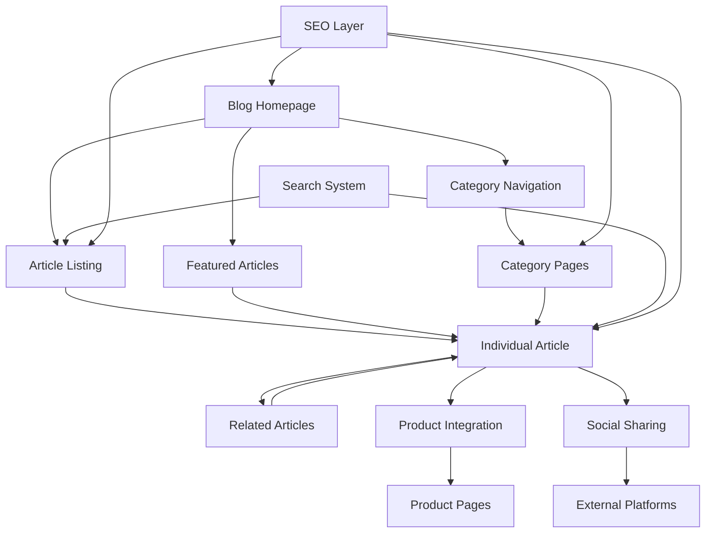

# Blog Redesign Design Document

## Overview

This design document outlines the comprehensive redesign of the Egyptian travel pillows blog, transforming it from Arabic-language components to a modern, professional English-language blog system. The design emphasizes cultural authenticity, premium brand positioning, SEO optimization, and exceptional user experience while maintaining respect for Egyptian heritage.

## Architecture

### System Architecture



### Component Hierarchy

```
BlogSystem/
├── BlogHomepage/
│   ├── HeroSection/
│   ├── FeaturedArticles/
│   ├── CategoryNavigation/
│   └── ArticleGrid/
├── ArticlePage/
│   ├── ArticleHeader/
│   ├── ArticleContent/
│   ├── ProductIntegration/
│   ├── RelatedArticles/
│   └── SocialSharing/
├── CategoryPage/
│   ├── CategoryHeader/
│   └── FilteredArticleGrid/
└── SearchResults/
    ├── SearchFilters/
    └── SearchResultsList/
```

## Components and Interfaces

### 1. Blog Homepage Component

**Purpose:** Main landing page showcasing featured content and navigation

**Key Features:**
- Hero section with latest featured article
- Category-based navigation with Egyptian symbol icons
- Grid layout for article previews
- Search functionality
- Newsletter signup integration

**Design Elements:**
- Egyptian-inspired color palette (Gold #D4AF37, Deep Blue #1E3A8A, Cream #FEF7ED)
- Hieroglyphic decorative elements
- Premium typography (Playfair Display for headings, Inter for body)
- Responsive grid system (1-2-3 columns based on screen size)

### 2. Article Page Component

**Purpose:** Individual article display with enhanced reading experience

**Key Features:**
- Reading progress indicator
- Table of contents for long articles
- Integrated product recommendations
- Social sharing buttons
- Related articles carousel
- Author bio section
- Comment system integration

**Design Elements:**
- Clean, readable typography with optimal line spacing
- Egyptian symbol icons for section breaks
- Gradient backgrounds for call-to-action sections
- Smooth scroll animations
- Mobile-optimized reading experience

### 3. Category Navigation Component

**Purpose:** Organize content by Egyptian symbols and themes

**Categories:**
- Ancient Figures (Anubis, Nefertiti, Cleopatra)
- Sacred Symbols (Eye of Horus, Ankh, Scarab)
- Monuments (Pyramids, Sphinx, Temples)
- Cultural Heritage (Art, History, Traditions)
- Travel & Comfort (Product Integration)

### 4. Search and Filter System

**Purpose:** Help users discover relevant content quickly

**Features:**
- Real-time search with autocomplete
- Filter by category, date, reading time
- Tag-based filtering
- Search result highlighting
- Popular searches suggestions

## Data Models

### Article Model (Enhanced)

```typescript
interface BlogArticle {
  // Basic Information
  id: string;
  title: string;
  slug: string;
  description: string;
  content: string;
  excerpt: string;
  
  // Publishing Information
  publishDate: string;
  lastModified: string;
  author: Author;
  status: 'draft' | 'published' | 'archived';
  
  // SEO Optimization
  seoTitle: string;
  metaDescription: string;
  keywords: {
    primary: string[];
    secondary: string[];
    longTail: string[];
  };
  canonicalUrl?: string;
  
  // Content Organization
  category: Category;
  tags: Tag[];
  readingTime: number;
  featured: boolean;
  priority: number;
  
  // Egyptian Symbol Integration
  symbol: {
    name: string;
    meaning: string;
    historicalPeriod: string;
    culturalSignificance: string;
    iconCode: string;
  };
  
  // Product Integration
  relatedProducts: string[];
  productRecommendations: ProductRecommendation[];
  
  // Media
  featuredImage: {
    url: string;
    alt: string;
    caption?: string;
  };
  gallery?: Image[];
  
  // Analytics
  viewCount: number;
  shareCount: number;
  engagementScore: number;
}
```

### Category Model

```typescript
interface Category {
  id: string;
  name: string;
  slug: string;
  description: string;
  icon: string;
  color: string;
  parentCategory?: string;
  articleCount: number;
  seoKeywords: string[];
}
```

### Author Model

```typescript
interface Author {
  id: string;
  name: string;
  bio: string;
  avatar: string;
  expertise: string[];
  socialLinks: {
    linkedin?: string;
    twitter?: string;
    website?: string;
  };
}
```

## Error Handling

### Content Loading Errors

1. **Article Not Found (404)**
   - Display custom 404 page with Egyptian theme
   - Suggest related articles based on URL path
   - Provide search functionality
   - Include navigation back to blog homepage

2. **Network Connectivity Issues**
   - Implement offline reading for cached articles
   - Show connection status indicator
   - Provide retry mechanisms
   - Cache critical content for offline access

3. **Image Loading Failures**
   - Progressive image loading with placeholders
   - Fallback to default Egyptian-themed images
   - Alt text for accessibility
   - Lazy loading for performance

### Search and Filter Errors

1. **No Search Results**
   - Display helpful "no results" message
   - Suggest alternative search terms
   - Show popular articles as fallback
   - Provide category browsing options

2. **Filter Combination Issues**
   - Clear indication when filters return no results
   - Suggest removing specific filters
   - Show total available articles per filter

## Testing Strategy

### Unit Testing

1. **Component Testing**
   - Article rendering with various content types
   - Search functionality with different queries
   - Filter combinations and edge cases
   - SEO meta tag generation
   - Product recommendation logic

2. **Utility Function Testing**
   - Content parsing and formatting
   - SEO keyword extraction
   - Reading time calculation
   - Related article algorithms

### Integration Testing

1. **User Journey Testing**
   - Homepage to article navigation
   - Search to article discovery
   - Article to product conversion flow
   - Social sharing functionality
   - Mobile responsive behavior

2. **SEO Testing**
   - Meta tag generation accuracy
   - Structured data validation
   - Sitemap generation
   - Internal linking verification

### Performance Testing

1. **Load Time Optimization**
   - Page load under 3 seconds
   - Image optimization and lazy loading
   - Code splitting for better performance
   - CDN integration for global access

2. **Mobile Performance**
   - Touch-friendly interface testing
   - Responsive design validation
   - Mobile-specific user flows
   - Offline functionality testing

### Accessibility Testing

1. **Screen Reader Compatibility**
   - ARIA labels for all interactive elements
   - Proper heading hierarchy
   - Alt text for all images
   - Keyboard navigation support

2. **Visual Accessibility**
   - Color contrast compliance (WCAG 2.1 AA)
   - Font size and readability
   - Focus indicators for keyboard users
   - High contrast mode support

## SEO Optimization Strategy

### Technical SEO

1. **Meta Tags and Structured Data**
   - Dynamic meta titles with target keywords
   - Compelling meta descriptions (150-160 characters)
   - Open Graph tags for social sharing
   - JSON-LD structured data for articles
   - Breadcrumb markup

2. **URL Structure**
   - SEO-friendly URLs with keywords
   - Consistent URL patterns
   - Proper canonical tags
   - XML sitemap generation

### Content SEO

1. **Keyword Integration**
   - Primary keywords in titles and headings
   - Natural keyword density (1-2%)
   - Long-tail keyword targeting
   - Semantic keyword variations
   - Internal linking with keyword-rich anchor text

2. **Content Optimization**
   - Optimal article length (1500-2500 words)
   - Proper heading hierarchy (H1-H6)
   - Image optimization with descriptive alt text
   - Related article suggestions
   - Fresh content updates

### Performance SEO

1. **Core Web Vitals**
   - Largest Contentful Paint (LCP) < 2.5s
   - First Input Delay (FID) < 100ms
   - Cumulative Layout Shift (CLS) < 0.1
   - Mobile-first indexing optimization

## Cultural Sensitivity Guidelines

### Content Guidelines

1. **Terminology Standards**
   - Use "ancient Egyptian figure" instead of "deity" or "god"
   - Refer to "mythological character" for cultural figures
   - Describe as "cultural symbol" or "historical figure"
   - Maintain educational and respectful tone

2. **Visual Representation**
   - Use authentic Egyptian art styles
   - Avoid stereotypical or cartoonish representations
   - Include proper cultural context
   - Respect sacred symbols and their meanings

### Translation Considerations

1. **Bilingual Support**
   - Maintain Arabic cultural references where appropriate
   - Provide English translations for Arabic terms
   - Include pronunciation guides for Egyptian names
   - Preserve cultural nuances in translation

## Brand Integration

### Visual Identity

1. **Color Palette**
   - Primary: Egyptian Gold (#D4AF37)
   - Secondary: Nile Blue (#1E3A8A)
   - Accent: Papyrus Cream (#FEF7ED)
   - Text: Charcoal (#374151)

2. **Typography**
   - Headlines: Playfair Display (elegant, readable)
   - Body: Inter (modern, clean)
   - Accent: Egyptian-inspired decorative font for symbols

3. **Iconography**
   - Authentic hieroglyphic symbols
   - Minimalist Egyptian motifs
   - Consistent icon style across components
   - Cultural accuracy in symbol usage

### Product Integration Strategy

1. **Contextual Recommendations**
   - Symbol-based product matching
   - Article content relevance scoring
   - User behavior-based suggestions
   - Seasonal and promotional integration

2. **Conversion Optimization**
   - Strategic CTA placement
   - Product showcase within articles
   - Trust signals and testimonials
   - Clear value propositions