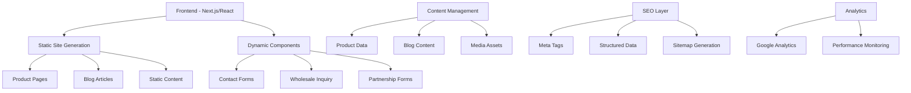

# Design Document

## Overview

The Pharaonic Pillows Website is a comprehensive B2B platform for an Egyptian company specializing in manufacturing Pharaonic travel pillows made from memory foam. The website will showcase Egyptian heritage through distinctive visual identity, provide detailed product catalogs for international distributors, and feature educational content about Pharaonic symbols to enhance SEO and brand authority.

## Architecture

### High-Level Architecture



### Technology Stack

- **Frontend Framework**: Next.js 14 with React 18
- **Styling**: Tailwind CSS with custom Egyptian theme
- **Animations**: Framer Motion for smooth interactions
- **Forms**: React Hook Form with validation
- **SEO**: Next.js built-in SEO optimization
- **Analytics**: Google Analytics 4
- **Deployment**: Static export for optimal performance

## Components and Interfaces

### Core Layout Components

```typescript
interface LayoutProps {
  children: React.ReactNode
  pageTitle: string
  metaDescription: string
  egyptianTheme?: 'gold' | 'blue' | 'terracotta'
}

interface NavigationProps {
  currentPage: string
  isMobile: boolean
  isScrolled: boolean
}

interface FooterProps {
  showPartnershipInfo: boolean
  contactInfo: ContactInfo
}
```

### Product System

```typescript
interface Product {
  id: string
  name: string
  category: 'b123' | 't' | 'tb'
  images: ProductImage[]
  description: ProductDescription
  specifications: ProductSpecs
  pharaonicDesign: PharaonicDesignInfo
  wholesaleInfo: WholesaleInfo
}

interface ProductDescription {
  shortDescription: string
  fullDescription: string
  egyptianStory: string
  memoryFoamBenefits: string[]
  seoKeywords: string[]
}

interface PharaonicDesignInfo {
  symbolsUsed: string[]
  culturalSignificance: string
  designInspiration: string
  colorMeaning: string
}

interface WholesaleInfo {
  minimumOrderQuantity: number
  bulkPricing: PricingTier[]
  packagingOptions: string[]
  shippingInfo: string
}
```

### Blog System

```typescript
interface BlogArticle {
  id: string
  title: string
  slug: string
  symbol: PharaonicSymbol
  content: ArticleContent
  seoData: SEOData
  relatedProducts: Product[]
}

interface PharaonicSymbol {
  name: string
  arabicName: string
  meaning: string
  historicalContext: string
  visualElements: string[]
  modernRelevance: string
}

interface ArticleContent {
  introduction: string
  sections: ContentSection[]
  conclusion: string
  callToAction: string
}
```

### Form Interfaces

```typescript
interface WholesaleInquiry {
  companyName: string
  contactPerson: string
  email: string
  phone: string
  country: string
  businessType: 'distributor' | 'retailer' | 'manufacturer'
  targetMarkets: string[]
  estimatedQuantity: number
  productsOfInterest: string[]
  message: string
}

interface PartnershipInquiry {
  companyProfile: CompanyProfile
  distributionCapabilities: DistributionInfo
  marketExperience: string
  proposedCollaboration: string
}
```

## Data Models

### Product Catalog Structure

```typescript
// Product categories based on existing image folders
const PRODUCT_CATEGORIES = {
  b123: {
    name: 'Premium Collection',
    description: 'Luxury Pharaonic travel pillows with intricate designs',
    targetMarket: 'High-end distributors and luxury retailers'
  },
  t: {
    name: 'Classic Collection', 
    description: 'Traditional Egyptian motifs on comfortable memory foam',
    targetMarket: 'General distributors and travel accessory retailers'
  },
  tb: {
    name: 'Heritage Collection',
    description: 'Extensive range featuring diverse Pharaonic symbols',
    targetMarket: 'Cultural institutions and specialty retailers'
  }
}

// SEO-optimized product data structure
interface ProductSEO {
  primaryKeywords: {
    arabic: string[]
    english: string[]
  }
  metaTitle: string
  metaDescription: string
  structuredData: ProductStructuredData
}
```

### Blog Content Structure

```typescript
const PHARAONIC_SYMBOLS = [
  {
    id: 'anubis',
    name: 'Anubis',
    arabicName: 'أنوبيس',
    meaning: 'God of Death and Afterlife',
    seoKeywords: ['أنوبيس', 'Anubis god', 'Egyptian death god', '  الموت المصري']
  },
  {
    id: 'scarab',
    name: 'Royal Scarab',
    arabicName: 'الجعران الملكي',
    meaning: 'Protection and Renewal',
    seoKeywords: ['الجعران الملكي', 'Royal Scarab', 'Egyptian scarab beetle', 'رمز الحماية المصري']
  },
  // ... 8 more symbols
]
```

## Visual Design System

### Egyptian Color Palette

```css
:root {
  /* Primary Egyptian Colors */
  --pharaonic-gold: #D4AF37;
  --deep-blue: #1E3A8A;
  --terracotta: #CD853F;
  --papyrus: #F5E6D3;
  
  /* Accent Colors */
  --hieroglyph-black: #1A1A1A;
  --desert-sand: #EDC9AF;
  --nile-blue: #4682B4;
  
  /* Modern Gradients (inspired by CapaCV design) */
  --golden-gradient: linear-gradient(135deg, #FFD700, #B8860B);
  --royal-gradient: linear-gradient(135deg, #1E3A8A, #3B82F6);
  --pharaonic-hero: linear-gradient(135deg, #6366F1, #8B5CF6, #D4AF37);
  --floating-shadow: rgba(212, 175, 55, 0.25);
  
  /* Interactive States */
  --hover-gold: linear-gradient(135deg, #FFD700, #B8860B, #DAA520);
  --card-shadow: 0 10px 40px rgba(0, 0, 0, 0.1);
  --card-hover-shadow: 0 25px 50px rgba(212, 175, 55, 0.3);
}

/* Modern Card Styling */
.egyptian-card {
  background: rgba(255, 255, 255, 0.95);
  backdrop-filter: blur(10px);
  border-radius: 20px;
  box-shadow: var(--card-shadow);
  border: 1px solid rgba(212, 175, 55, 0.1);
  transition: all 0.3s ease;
}

.egyptian-card:hover {
  transform: translateY(-10px) rotateX(5deg) rotateY(5deg);
  box-shadow: var(--card-hover-shadow);
}

/* Polygon Clip Path for Images */
.pharaonic-polygon {
  clip-path: polygon(30% 0%, 70% 30%, 100% 70%, 70% 100%, 30% 70%, 0% 30%);
  transition: clip-path 0.5s ease;
}

/* Interactive Button Styling */
.golden-button {
  background: var(--golden-gradient);
  border: none;
  border-radius: 12px;
  padding: 12px 24px;
  color: white;
  font-weight: 600;
  cursor: pointer;
  transition: all 0.3s ease;
  box-shadow: 0 4px 15px rgba(212, 175, 55, 0.2);
}

.golden-button:hover {
  background: var(--hover-gold);
  transform: scale(1.05);
  box-shadow: 0 8px 25px rgba(212, 175, 55, 0.4);
}
```

### Typography System

```css
/* Arabic-English Compatible Fonts */
.font-pharaonic {
  font-family: 'Amiri', 'Playfair Display', serif;
}

.font-hieroglyphic {
  font-family: 'Noto Sans Egyptian Hieroglyphs', serif;
}

.font-modern-arabic {
  font-family: 'Cairo', 'Inter', sans-serif;
}
```

### Animation Patterns

```typescript
// Egyptian-themed animations inspired by modern UI patterns
const EGYPTIAN_ANIMATIONS = {
  // Polygon effect for product images (inspired by CapaCV design)
  pharaonicPolygon: {
    initial: { clipPath: "polygon(0% 0%, 100% 0%, 100% 100%, 0% 100%)" },
    animate: { 
      clipPath: [
        "polygon(0% 0%, 100% 0%, 100% 100%, 0% 100%)",
        "polygon(20% 0%, 80% 20%, 100% 60%, 80% 100%, 20% 80%, 0% 40%)",
        "polygon(30% 0%, 70% 30%, 100% 70%, 70% 100%, 30% 70%, 0% 30%)"
      ]
    },
    transition: { duration: 3, repeat: Infinity, repeatType: "reverse" }
  },

  // Floating card effect for products
  floatingCard: {
    initial: { y: 0, rotateX: 0, rotateY: 0 },
    hover: { 
      y: -10, 
      rotateX: 5, 
      rotateY: 5,
      boxShadow: "0 25px 50px rgba(212, 175, 55, 0.3)"
    },
    transition: { duration: 0.3, ease: "easeOut" }
  },

  // Gradient background animation
  egyptianGradient: {
    initial: { backgroundPosition: "0% 50%" },
    animate: { backgroundPosition: "100% 50%" },
    transition: { duration: 5, repeat: Infinity, repeatType: "reverse" }
  },

  // Interactive button with Egyptian flair
  goldenButton: {
    initial: { scale: 1, boxShadow: "0 4px 15px rgba(212, 175, 55, 0.2)" },
    hover: { 
      scale: 1.05, 
      boxShadow: "0 8px 25px rgba(212, 175, 55, 0.4)",
      background: "linear-gradient(135deg, #FFD700, #B8860B, #DAA520)"
    },
    tap: { scale: 0.95 },
    transition: { duration: 0.2 }
  },

  // Scarab flying animation
  scarabFly: {
    initial: { x: -100, rotate: 0 },
    animate: { x: 0, rotate: 360 },
    transition: { duration: 2, ease: "easeInOut" }
  },
  
  // Pyramid building effect
  pyramidBuild: {
    initial: { scaleY: 0, originY: 1 },
    animate: { scaleY: 1 },
    transition: { duration: 1.5, ease: "easeOut" }
  },
  
  // Hieroglyph reveal with stagger
  hieroglyphReveal: {
    initial: { opacity: 0, y: 20 },
    animate: { opacity: 1, y: 0 },
    transition: { duration: 0.8, staggerChildren: 0.1 }
  },

  // Modern card entrance (inspired by CapaCV)
  cardEntrance: {
    initial: { opacity: 0, y: 60, rotateX: -15 },
    animate: { opacity: 1, y: 0, rotateX: 0 },
    transition: { duration: 0.6, ease: "easeOut" }
  }
}
```

## Error Handling

### Form Validation

```typescript
interface FormValidation {
  validateWholesaleInquiry(data: WholesaleInquiry): ValidationResult
  validatePartnershipForm(data: PartnershipInquiry): ValidationResult
  validateContactForm(data: ContactForm): ValidationResult
}

interface ValidationResult {
  isValid: boolean
  errors: FieldError[]
  warnings?: FieldWarning[]
}
```

### Error Boundaries

```typescript
class EgyptianErrorBoundary extends React.Component {
  // Custom error boundary with Egyptian-themed error pages
  // Graceful fallbacks for component failures
  // Error reporting to analytics
}
```

## Testing Strategy

### Component Testing
- Test all product display components with sample data
- Validate form submissions and error handling
- Test responsive design across device sizes
- Verify Egyptian theme consistency

### Content Testing
- Validate SEO meta tags and structured data
- Test Arabic and English text rendering
- Verify internal linking between blog and products
- Test image optimization and loading

### Performance Testing
- Core Web Vitals optimization
- Image loading performance with Egyptian graphics
- Animation performance on mobile devices
- SEO crawlability testing

### Accessibility Testing
- Arabic RTL text support
- Keyboard navigation for all interactive elements
- Screen reader compatibility
- Color contrast compliance with Egyptian theme

## SEO Implementation

### Technical SEO

```typescript
// Next.js SEO configuration
const seoConfig = {
  defaultTitle: 'Egyptian Pharaonic Travel Pillows | Memory Foam | B2B Wholesale',
  titleTemplate: '%s | Pharaonic Pillows Egypt',
  description: 'Premium Egyptian Pharaonic travel pillows made from memory foam. B2B wholesale for international distributors. Authentic Egyptian designs and superior comfort.',
  
  openGraph: {
    type: 'website',
    locale: 'en_US',
    alternateLocales: ['ar_EG'],
    siteName: 'Pharaonic Pillows Egypt'
  },
  
  additionalMetaTags: [
    {
      name: 'keywords',
      content: 'مخدات سفر فرعونية, Egyptian travel pillows, memory foam Egypt, Pharaonic design pillows'
    }
  ]
}
```

### Content SEO Strategy

```typescript
// Blog article SEO optimization
interface BlogSEO {
  targetKeywords: {
    primary: string
    secondary: string[]
    longTail: string[]
  }
  internalLinks: {
    relatedProducts: Product[]
    relatedArticles: BlogArticle[]
  }
  structuredData: {
    article: ArticleStructuredData
    breadcrumbs: BreadcrumbStructuredData
  }
}
```

## Security Considerations

### Form Security
- Input sanitization for all form submissions
- CSRF protection for form endpoints
- Rate limiting for contact and inquiry forms
- Spam protection with honeypot fields

### Content Security
- Image optimization and compression
- Secure handling of uploaded content
- XSS prevention in dynamic content rendering
- Safe rendering of user-generated content in testimonials

## Performance Optimization

### Image Optimization
- Next.js Image component for automatic optimization
- WebP format with fallbacks for Egyptian graphics
- Lazy loading for product galleries
- Responsive images for different screen sizes

### Code Splitting
- Route-based code splitting for different sections
- Dynamic imports for heavy animation libraries
- Separate bundles for Arabic and English content
- Optimized loading for blog content

### Caching Strategy
- Static generation for product pages and blog articles
- CDN caching for images and static assets
- Browser caching for Egyptian theme assets
- Service worker for offline functionality
#
# Modern Visual Effects (Inspired by CapaCV Design)

### Crystal/Polygonal Effects for Product Images

```css
/* Pharaonic Crystal Effect for Product Images */
.pharaonic-crystal-effect {
  clip-path: polygon(20% 0%, 80% 0%, 100% 20%, 100% 80%, 80% 100%, 20% 100%, 0% 80%, 0% 20%);
  filter: drop-shadow(0 10px 30px rgba(212, 175, 55, 0.3));
  transition: all 0.3s ease;
}

.pharaonic-crystal-effect:hover {
  transform: scale(1.05) rotateY(5deg);
  filter: drop-shadow(0 15px 40px rgba(212, 175, 55, 0.4));
}

/* Egyptian Gradient Backgrounds */
.egyptian-hero-gradient {
  background: linear-gradient(135deg, #D4AF37 0%, #1E3A8A 50%, #CD853F 100%);
  background-size: 200% 200%;
  animation: gradientShift 6s ease infinite;
}

@keyframes gradientShift {
  0% { background-position: 0% 50%; }
  50% { background-position: 100% 50%; }
  100% { background-position: 0% 50%; }
}
```

### Advanced Animation Patterns

```typescript
// Modern Egyptian-themed animations inspired by CapaCV
const ADVANCED_ANIMATIONS = {
  // Crystal reveal effect for products
  pharaonicCrystalReveal: {
    initial: { 
      opacity: 0, 
      scale: 0.8, 
      rotateY: -15,
      clipPath: "polygon(50% 50%, 50% 50%, 50% 50%, 50% 50%)"
    },
    animate: { 
      opacity: 1, 
      scale: 1, 
      rotateY: 0,
      clipPath: "polygon(20% 0%, 80% 0%, 100% 20%, 100% 80%, 80% 100%, 20% 100%, 0% 80%, 0% 20%)"
    },
    transition: { duration: 1.2, ease: "easeOut" }
  },
  
  // Staggered content reveal like CapaCV
  contentStagger: {
    initial: { opacity: 0, y: 60, scale: 0.95 },
    animate: { opacity: 1, y: 0, scale: 1 },
    transition: { 
      duration: 0.8, 
      staggerChildren: 0.15, 
      ease: [0.25, 0.46, 0.45, 0.94] 
    }
  },
  
  // Floating elements with Egyptian theme
  floatingHieroglyphs: {
    animate: {
      y: [-10, 10, -10],
      rotate: [-2, 2, -2],
      scale: [1, 1.02, 1]
    },
    transition: {
      duration: 4,
      repeat: Infinity,
      ease: "easeInOut"
    }
  },
  
  // Button hover effects
  pharaonicButton: {
    initial: { scale: 1 },
    hover: { 
      scale: 1.05,
      boxShadow: "0 10px 25px rgba(212, 175, 55, 0.4)",
      background: "linear-gradient(45deg, #FFD700, #B8860B)"
    },
    tap: { scale: 0.98 }
  }
}

// Layout effects inspired by modern design
const LAYOUT_EFFECTS = {
  asymmetricalGrid: {
    display: "grid",
    gridTemplateColumns: "1.2fr 0.8fr",
    gap: "2rem",
    alignItems: "center"
  },
  
  modernCard: {
    background: "rgba(255, 255, 255, 0.95)",
    backdropFilter: "blur(10px)",
    borderRadius: "20px",
    padding: "2rem",
    boxShadow: "0 20px 40px rgba(0, 0, 0, 0.1)"
  }
}
```

### Interactive Elements Design

```typescript
// Form styling inspired by CapaCV
const FORM_STYLES = {
  modernInput: {
    background: "linear-gradient(135deg, #667eea 0%, #764ba2 100%)",
    border: "none",
    borderRadius: "12px",
    padding: "1rem 1.5rem",
    color: "white",
    placeholder: "rgba(255, 255, 255, 0.7)",
    fontSize: "1rem",
    transition: "all 0.3s ease"
  },
  
  inputFocus: {
    transform: "translateY(-2px)",
    boxShadow: "0 10px 20px rgba(102, 126, 234, 0.3)"
  }
}

// Typography hierarchy like CapaCV
const TYPOGRAPHY_SYSTEM = {
  heroTitle: {
    fontSize: "clamp(2.5rem, 5vw, 4rem)",
    fontWeight: "700",
    lineHeight: "1.1",
    letterSpacing: "-0.02em"
  },
  
  subtitle: {
    fontSize: "1.125rem",
    fontWeight: "400",
    opacity: "0.8",
    lineHeight: "1.6"
  },
  
  bulletPoints: {
    fontSize: "0.95rem",
    lineHeight: "1.8",
    opacity: "0.7"
  }
}
```