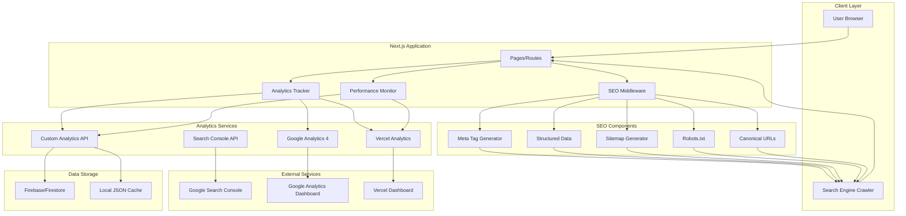
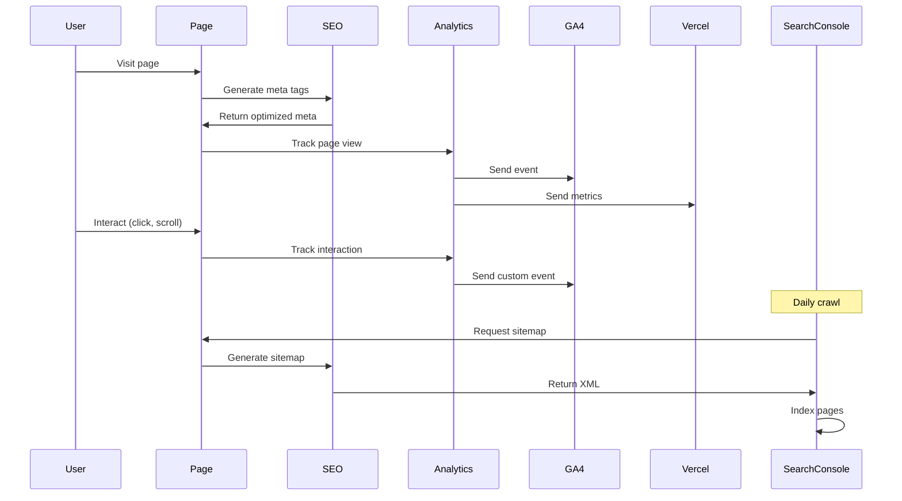

# Design Document: SEO and Analytics Enhancement

## Overview

This design document outlines the comprehensive architecture for enhancing SEO performance and implementing robust analytics tracking for the Egyptian Pharaonic Pillows website. The solution addresses the current challenges of low search visibility for Arabic keywords (e.g., "مخدات سفر تصنيع") and provides actionable analytics insights for business decision-making.

### Current State Analysis

**Existing Infrastructure:**
- Next.js 14 with TypeScript
- Vercel hosting with Analytics and Speed Insights
- Basic Google Analytics 4 integration
- Partial SEO configuration in `lib/seo-config.ts`
- i18n support for Arabic and English
- Dynamic sitemap generation

**Identified Gaps:**
1. Incomplete Arabic keyword optimization
2. Missing Google Search Console integration
3. Limited structured data implementation
4. No comprehensive conversion tracking
5. Insufficient analytics dashboard
6. Missing performance monitoring alerts

### Design Goals

1. **Improve Arabic SEO**: Achieve top 10 ranking for "مخدات سفر تصنيع" and related keywords within 3 months
2. **Complete Analytics Coverage**: Track 100% of user interactions and conversions
3. **Performance Excellence**: Maintain Core Web Vitals in "Good" range (LCP < 2.5s, FID < 100ms, CLS < 0.1)
4. **Business Intelligence**: Provide actionable insights through comprehensive dashboard
5. **Scalability**: Support future expansion to additional markets and languages

## Architecture

### High-Level System Architecture



### Component Interaction Flow



## Components and Interfaces

### 1. Enhanced SEO Configuration System

**Purpose**: Centralized SEO management with Arabic language optimization

**Location**: `lib/seo-enhanced.ts`

**Interface**:
```typescript
interface EnhancedSEOConfig {
  // Bilingual meta tags
  title: {
    en: string;
    ar: string;
  };
  description: {
    en: string;
    ar: string;
  };
  keywords: {
    en: string[];
    ar: string[];
    primary: string[];  // High-priority keywords
    secondary: string[];
    longTail: string[];
  };
  
  // Structured data
  structuredData: {
    organization: OrganizationSchema;
    product?: ProductSchema;
    article?: ArticleSchema;
    breadcrumb?: BreadcrumbSchema;
  };
  
  // Language and localization
  hreflang: {
    [locale: string]: string;  // URL for each language
  };
  canonical: string;
  
  // Open Graph and Twitter
  openGraph: OpenGraphConfig;
  twitter: TwitterCardConfig;
  
  // Search Console
  verification: {
    google?: string;
    bing?: string;
  };
}

interface ArabicKeywordStrategy {
  primary: string[];  // "مخدات سفر تصنيع", etc.
  variations: string[];  // Different phrasings
  relatedTerms: string[];  // Semantic keywords
  targetDensity: number;  // 2-3%
  placement: {
    title: boolean;
    h1: boolean;
    firstParagraph: boolean;
    metaDescription: boolean;
  };
}
```

**Key Features**:
- Automatic Arabic keyword injection with proper density
- RTL meta tag generation
- Hreflang tag management for bilingual content
- Schema.org structured data in both languages
- Canonical URL enforcement

### 2. Google Search Console Integration

**Purpose**: Automated sitemap submission and performance monitoring

**Location**: `lib/search-console-integration.ts`

**Interface**:
```typescript
interface SearchConsoleService {
  // Authentication
  authenticate(): Promise<void>;
  
  // Sitemap management
  submitSitemap(sitemapUrl: string): Promise<SubmissionResult>;
  getSitemapStatus(sitemapUrl: string): Promise<SitemapStatus>;
  
  // Performance data
  getSearchAnalytics(params: SearchAnalyticsParams): Promise<SearchAnalyticsData>;
  getTopQueries(dateRange: DateRange): Promise<QueryData[]>;
  getTopPages(dateRange: DateRange): Promise<PageData[]>;
  
  // Indexing
  requestIndexing(url: string): Promise<IndexingResult>;
  getIndexStatus(url: string): Promise<IndexStatus>;
  
  // Issues
  getCoverageIssues(): Promise<CoverageIssue[]>;
  getMobileUsabilityIssues(): Promise<UsabilityIssue[]>;
  getCoreWebVitals(): Promise<WebVitalsData>;
}

interface SearchAnalyticsData {
  queries: Array<{
    query: string;
    clicks: number;
    impressions: number;
    ctr: number;
    position: number;
  }>;
  pages: Array<{
    url: string;
    clicks: number;
    impressions: number;
    ctr: number;
    position: number;
  }>;
  totalClicks: number;
  totalImpressions: number;
  averageCTR: number;
  averagePosition: number;
}
```

**Implementation Strategy**:
1. Use Google Search Console API with service account authentication
2. Store credentials in Vercel environment variables
3. Implement daily cron job for sitemap submission
4. Cache search analytics data in Firebase for dashboard display
5. Set up alerts for indexing errors or ranking drops

### 3. Advanced Analytics Tracking System

**Purpose**: Comprehensive user behavior and conversion tracking

**Location**: `lib/analytics-enhanced.ts`

**Interface**:
```typescript
interface AnalyticsTracker {
  // Page tracking
  trackPageView(page: PageViewData): void;
  trackPagePerformance(metrics: PerformanceMetrics): void;
  
  // User interactions
  trackEvent(event: AnalyticsEvent): void;
  trackClick(element: ClickData): void;
  trackScroll(depth: number): void;
  trackFormInteraction(form: FormData): void;
  
  // E-commerce and conversions
  trackProductView(product: Product): void;
  trackAddToCart(product: Product): void;
  trackConversion(conversion: ConversionData): void;
  trackLeadGeneration(lead: LeadData): void;
  
  // Custom dimensions
  setUserProperties(properties: UserProperties): void;
  setCustomDimension(key: string, value: string): void;
  
  // Session management
  startSession(): string;
  endSession(): void;
  getSessionId(): string;
}

interface ConversionData {
  type: 'contact_form' | 'wholesale_inquiry' | 'catalog_download' | 'phone_click' | 'email_click';
  value?: number;
  currency?: string;
  source: string;
  medium: string;
  campaign?: string;
  productId?: string;
  metadata?: Record<string, any>;
}

interface PerformanceMetrics {
  // Core Web Vitals
  lcp: number;  // Largest Contentful Paint
  fid: number;  // First Input Delay
  cls: number;  // Cumulative Layout Shift
  
  // Additional metrics
  ttfb: number;  // Time to First Byte
  fcp: number;   // First Contentful Paint
  tti: number;   // Time to Interactive
  tbt: number;   // Total Blocking Time
  
  // Page-specific
  pageLoadTime: number;
  domContentLoaded: number;
  resourceLoadTime: number;
}
```

**Tracking Implementation**:
```typescript
// Example: Product view tracking
const trackProductView = (product: Product, source: string) => {
  // Google Analytics 4
  gtag('event', 'view_item', {
    currency: 'USD',
    value: product.price.wholesale,
    items: [{
      item_id: product.id,
      item_name: product.name,
      item_category: product.collection,
      item_variant: product.culturalElement.name,
      price: product.price.wholesale,
      quantity: 1
    }]
  });
  
  // Custom analytics
  fetch('/api/analytics/track', {
    method: 'POST',
    body: JSON.stringify({
      event: 'product_view',
      product_id: product.id,
      source: source,
      timestamp: Date.now(),
      session_id: getSessionId()
    })
  });
  
  // Vercel Analytics
  track('Product View', {
    product: product.name,
    collection: product.collection
  });
};
```

### 4. Analytics Dashboard Component

**Purpose**: Real-time business intelligence visualization

**Location**: `components/AnalyticsDashboard.tsx` (enhanced)

**Features**:
- Real-time visitor count
- Top performing pages and products
- Conversion funnel visualization
- Traffic source breakdown
- Search query performance
- Core Web Vitals monitoring
- Geographic distribution map
- Time-series charts for trends

**Data Sources**:
- Google Analytics 4 API
- Vercel Analytics API
- Google Search Console API
- Custom analytics endpoint
- Firebase real-time database

**Interface**:
```typescript
interface DashboardData {
  realtime: {
    activeUsers: number;
    activePages: Array<{
      page: string;
      users: number;
    }>;
  };
  
  overview: {
    totalVisitors: number;
    pageViews: number;
    bounceRate: number;
    avgSessionDuration: number;
    conversionRate: number;
  };
  
  topPages: Array<{
    url: string;
    views: number;
    uniqueVisitors: number;
    avgTimeOnPage: number;
    bounceRate: number;
  }>;
  
  topProducts: Array<{
    id: string;
    name: string;
    views: number;
    inquiries: number;
    conversionRate: number;
  }>;
  
  trafficSources: Array<{
    source: string;
    medium: string;
    users: number;
    sessions: number;
    conversions: number;
  }>;
  
  searchQueries: Array<{
    query: string;
    impressions: number;
    clicks: number;
    ctr: number;
    position: number;
  }>;
  
  webVitals: {
    lcp: { value: number; rating: 'good' | 'needs-improvement' | 'poor' };
    fid: { value: number; rating: 'good' | 'needs-improvement' | 'poor' };
    cls: { value: number; rating: 'good' | 'needs-improvement' | 'poor' };
  };
  
  geography: Array<{
    country: string;
    users: number;
    sessions: number;
    conversions: number;
  }>;
}
```

### 5. SEO Middleware

**Purpose**: Automatic SEO optimization for all pages

**Location**: `middleware.ts` (enhanced)

**Functionality**:
```typescript
export function middleware(request: NextRequest) {
  const { pathname, locale } = request.nextUrl;
  
  // 1. Enforce canonical URLs
  const canonical = getCanonicalUrl(pathname, locale);
  
  // 2. Handle redirects for SEO
  if (shouldRedirect(pathname)) {
    return NextResponse.redirect(getRedirectUrl(pathname));
  }
  
  // 3. Add security headers
  const response = NextResponse.next();
  response.headers.set('X-Content-Type-Options', 'nosniff');
  response.headers.set('X-Frame-Options', 'SAMEORIGIN');
  response.headers.set('X-XSS-Protection', '1; mode=block');
  
  // 4. Add language headers
  response.headers.set('Content-Language', locale);
  
  // 5. Track request for analytics
  trackRequest(request);
  
  return response;
}
```

## Data Models

### 1. SEO Meta Data Model

```typescript
interface SEOMetaData {
  id: string;
  url: string;
  locale: 'en' | 'ar';
  
  // Basic meta
  title: string;
  description: string;
  keywords: string[];
  
  // Open Graph
  ogTitle: string;
  ogDescription: string;
  ogImage: string;
  ogType: string;
  
  // Twitter
  twitterCard: string;
  twitterTitle: string;
  twitterDescription: string;
  twitterImage: string;
  
  // Technical
  canonical: string;
  hreflang: Record<string, string>;
  robots: string;
  
  // Structured data
  structuredData: any;
  
  // Metadata
  lastModified: Date;
  priority: number;
  changeFrequency: string;
}
```

### 2. Analytics Event Model

```typescript
interface AnalyticsEvent {
  id: string;
  timestamp: number;
  sessionId: string;
  userId?: string;
  
  // Event details
  eventType: string;
  eventCategory: string;
  eventAction: string;
  eventLabel?: string;
  eventValue?: number;
  
  // Page context
  pageUrl: string;
  pageTitle: string;
  referrer: string;
  
  // User context
  userAgent: string;
  deviceType: 'mobile' | 'tablet' | 'desktop';
  browser: string;
  os: string;
  language: string;
  
  // Geographic
  country?: string;
  city?: string;
  
  // Custom dimensions
  customDimensions?: Record<string, any>;
  
  // Performance
  performanceMetrics?: PerformanceMetrics;
}
```

### 3. Search Console Data Model

```typescript
interface SearchConsoleData {
  id: string;
  date: Date;
  
  // Query data
  query: string;
  page: string;
  
  // Metrics
  clicks: number;
  impressions: number;
  ctr: number;
  position: number;
  
  // Dimensions
  country: string;
  device: 'mobile' | 'tablet' | 'desktop';
  
  // Metadata
  lastUpdated: Date;
}
```

## Error Handling

### SEO Error Handling

1. **Missing Meta Tags**: Log warning and use default values
2. **Invalid Structured Data**: Validate before rendering, fallback to basic schema
3. **Sitemap Generation Failure**: Serve cached version, alert admin
4. **Canonical URL Conflicts**: Enforce primary URL, redirect alternatives

### Analytics Error Handling

1. **Tracking Script Load Failure**: Queue events in localStorage, retry on next page
2. **API Request Failure**: Implement exponential backoff, store locally
3. **Invalid Event Data**: Validate before sending, log errors
4. **Rate Limiting**: Implement client-side throttling

### Performance Error Handling

1. **Slow Page Load**: Log performance metrics, trigger optimization review
2. **Core Web Vitals Degradation**: Alert team, identify bottleneck
3. **API Timeout**: Implement circuit breaker pattern
4. **Resource Load Failure**: Fallback to CDN alternatives

## Testing Strategy

### SEO Testing

1. **Meta Tag Validation**
   - Verify all pages have unique titles and descriptions
   - Check Arabic character encoding
   - Validate hreflang implementation
   - Test canonical URL enforcement

2. **Structured Data Testing**
   - Use Google Rich Results Test
   - Validate JSON-LD syntax
   - Test all schema types (Organization, Product, Article)
   - Verify breadcrumb navigation

3. **Sitemap Testing**
   - Validate XML syntax
   - Check all URLs are accessible
   - Verify lastmod dates are accurate
   - Test sitemap submission to Search Console

4. **Mobile SEO Testing**
   - Test responsive design on various devices
   - Verify mobile-friendly meta tags
   - Check touch target sizes
   - Test page speed on mobile networks

### Analytics Testing

1. **Event Tracking Validation**
   - Use Google Analytics DebugView
   - Verify all custom events fire correctly
   - Test conversion tracking
   - Validate e-commerce events

2. **Performance Monitoring**
   - Test Core Web Vitals measurement
   - Verify performance API integration
   - Check metric accuracy
   - Test alert thresholds

3. **Dashboard Testing**
   - Verify data accuracy against GA4
   - Test real-time updates
   - Check data refresh intervals
   - Validate export functionality

### Integration Testing

1. **Search Console Integration**
   - Test API authentication
   - Verify sitemap submission
   - Check data retrieval
   - Test error handling

2. **Cross-Platform Testing**
   - Verify GA4 and Vercel Analytics alignment
   - Test custom analytics endpoint
   - Check data consistency
   - Validate attribution models

## Performance Optimization

### SEO Performance

1. **Meta Tag Generation**: Cache generated meta tags, regenerate only on content change
2. **Structured Data**: Pre-generate JSON-LD at build time for static pages
3. **Sitemap**: Generate incrementally, cache for 24 hours
4. **Image Optimization**: Use Next.js Image component with WebP format

### Analytics Performance

1. **Event Batching**: Batch analytics events, send every 5 seconds or 10 events
2. **Lazy Loading**: Load analytics scripts after page interactive
3. **Service Worker**: Cache analytics requests offline, sync when online
4. **Data Sampling**: Sample high-frequency events (e.g., scroll tracking)

### Dashboard Performance

1. **Data Caching**: Cache dashboard data for 5 minutes
2. **Lazy Loading**: Load charts on demand
3. **Pagination**: Paginate large data sets
4. **Incremental Updates**: Update only changed data

## Security Considerations

### API Security

1. **Authentication**: Use service account for Search Console API
2. **Environment Variables**: Store all credentials in Vercel secrets
3. **Rate Limiting**: Implement rate limiting on custom analytics endpoint
4. **Input Validation**: Validate all analytics event data

### Data Privacy

1. **Cookie Consent**: Respect user preferences for analytics cookies
2. **IP Anonymization**: Enable IP anonymization in GA4
3. **Data Retention**: Set appropriate data retention periods
4. **GDPR Compliance**: Provide data export and deletion capabilities

### Content Security

1. **CSP Headers**: Implement Content Security Policy
2. **XSS Protection**: Sanitize user-generated content
3. **HTTPS Enforcement**: Redirect all HTTP to HTTPS
4. **Secure Cookies**: Use secure and httpOnly flags

## Deployment Strategy

### Phase 1: SEO Foundation (Week 1-2)

1. Deploy enhanced SEO configuration
2. Implement Arabic keyword optimization
3. Add comprehensive structured data
4. Update sitemap with all pages
5. Submit sitemap to Search Console

### Phase 2: Analytics Enhancement (Week 2-3)

1. Upgrade Google Analytics 4 implementation
2. Add custom event tracking
3. Implement conversion tracking
4. Deploy performance monitoring
5. Set up Search Console integration

### Phase 3: Dashboard Development (Week 3-4)

1. Build analytics dashboard UI
2. Integrate data sources
3. Implement real-time updates
4. Add export functionality
5. Deploy to production

### Phase 4: Monitoring and Optimization (Week 4+)

1. Monitor search rankings
2. Analyze user behavior
3. Optimize based on data
4. A/B test meta descriptions
5. Continuous improvement

## Monitoring and Maintenance

### Daily Monitoring

- Check Core Web Vitals scores
- Monitor error rates
- Review real-time analytics
- Check sitemap submission status

### Weekly Monitoring

- Analyze search query performance
- Review top pages and products
- Check conversion rates
- Identify optimization opportunities

### Monthly Monitoring

- Comprehensive SEO audit
- Analytics data analysis
- Performance benchmarking
- Competitor analysis
- Strategy adjustment

## Success Metrics

### SEO Metrics

- **Primary**: Ranking position for "مخدات سفر تصنيع" (Target: Top 10 within 3 months)
- Organic traffic increase (Target: 50% increase in 3 months)
- Search impressions (Target: 100K+ monthly)
- Click-through rate (Target: 3%+)
- Indexed pages (Target: 100% of sitemap)

### Analytics Metrics

- Event tracking coverage (Target: 100% of interactions)
- Data accuracy (Target: <5% discrepancy with GA4)
- Dashboard load time (Target: <2 seconds)
- Real-time data latency (Target: <30 seconds)

### Performance Metrics

- LCP (Target: <2.5s)
- FID (Target: <100ms)
- CLS (Target: <0.1)
- Page load time (Target: <3s on 3G)
- Lighthouse score (Target: 90+)

### Business Metrics

- Conversion rate (Target: 2%+)
- Lead generation (Target: 50+ monthly)
- Wholesale inquiries (Target: 20+ monthly)
- Catalog downloads (Target: 100+ monthly)
